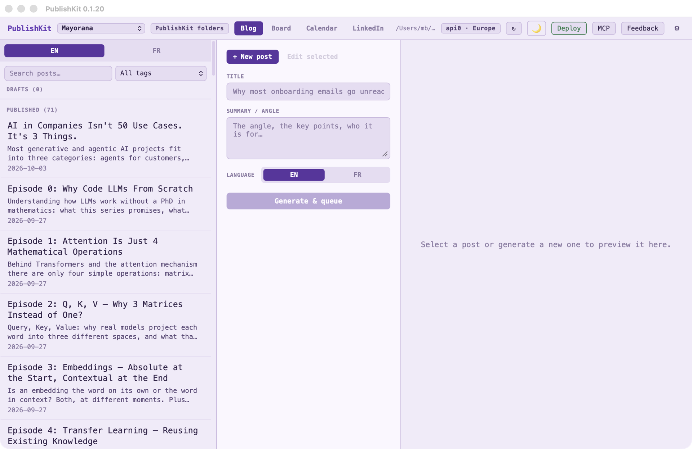

# PublishKit



Desktop app for writing, queuing, and publishing blog posts — powered by api0, in Europe, China or the United States.

Built with [Dioxus](https://dioxuslabs.com/) (Rust, runs natively on macOS, Linux, Windows).

---

## Installation

### macOS (Apple Silicon)
Download [`publishkit-macos-arm64.dmg`](https://mayorana.ch/downloads/publishkit/latest/publishkit-macos-arm64.dmg), open it, and drag **PublishKit** to Applications.
Signed with Apple Developer ID and notarized — opens with a normal double-click.
No admin rights? Drag it to the Applications folder in your home folder
(`~/Applications`) instead.

Publishing shells out to Node.js. If you do not already have Node 18+, run the
`setup-mac.sh` included in the disk image once. It needs no admin rights: it
uses Homebrew if you have it, otherwise it puts Node.js in `~/.local/nodejs`.

### Windows
Download **publishkit-setup.exe** from the [latest release](https://github.com/Bennekrouf/publishkit/releases/latest) and run it. The installer handles Node.js and WebView2 automatically.
It installs for your account only, without admin rights; choose *Install for all
users* in its first dialog for a machine-wide install.

### Linux (x86_64)
```bash
curl -L https://mayorana.ch/downloads/publishkit/latest/publishkit-linux-x86_64.tar.gz | tar xz
cd publishkit-linux-x86_64
./setup-linux.sh
./publishkit
```

`setup-linux.sh` runs without sudo: Node.js goes into `~/.local/nodejs` and the
launcher into your own applications menu.

> **Runtime requirement (Linux):** `libwebkit2gtk-4.1` — preinstalled on most desktops. If it is missing, `setup-linux.sh` installs it on Debian/Ubuntu, Fedora, and Arch, which is the one step that asks for your password; without admin rights, it names the package to ask your administrator for.

---

## Supported sites

On first launch you pick your site's folder; PublishKit recognises how it is built and
saves what it found in `publishkit.yaml` at the site's root. Change it under **⚙ Settings →
This site**.

| Built with | Where posts are | How a draft is told apart | New posts |
|---|---|---|---|
| PublishKit folders | `content/{lang}/blog` | its own folder, `content/{lang}/queue` | YAML, `status: "draft"` |
| Hugo | `content/posts` (or `content/{lang}/posts`) | `draft = true` | TOML or YAML, as the site's posts |
| Jekyll | `_posts` | its own folder, `_drafts`; the date is added to the file name on publishing | YAML |
| Astro | `src/content/blog` | `draft: true` | YAML, `.md` or `.mdx` |
| Eleventy | `posts`, `blog`, `src/posts`… | `draft: true` | YAML |
| Zola | `content/blog` | `draft = true` | TOML |
| Docusaurus | `blog` | `draft: true` | YAML |
| Next.js | `content/posts`, `posts`, `_posts`… | `draft: true` | YAML, `.md` or `.mdx` |
| Markdown folder | `posts`, `_posts`, `blog`, `articles` | `draft: true` | YAML |

Any number of languages: every `content/{lang}/…` folder is one, and so is every language a
Hugo or Zola site marks in its file names (`post.md` beside `post.fr.md`, a bundle's
`index.fr.md`; the unmarked files are in the site's `defaultContentLanguage` /
`default_language`). Translating a post there writes its counterpart under the marked name. Front matter is read with a
real YAML or TOML parser, and PublishKit only ever changes the lines of the keys it sets, so
fields it doesn't know and comments are kept.

Posts kept as page bundles — a folder per post, `my-post/index.md` beside its images — are
listed, published and deleted as a whole folder, and a site whose posts are bundles gets its
new posts as bundles too. Images added to a bundle go into its folder.

**The post list** can be widened by dragging its right edge (double-click it to reset): the
titles grow, the buttons move beside them and a line or two of each post's description shows.

**Writing.** The editor has a formatting bar — bold, italic, link, headings, list, quote,
code — with ⌘B, ⌘I and ⌘K, and takes images pasted from the clipboard as well as dropped ones.

**Several sites.** The site menu at the top left switches between the sites you've opened
and opens another; the start screen lists them too.

---

## Features

### Three-panel layout

| Panel | What it does |
|---|---|
| **Left** | Lists drafts and published posts, one tab per language. Click a post to load it. Publish or delete drafts directly. |
| **Center** | New post form (title + summary + language → AI generation) or raw markdown editor for the selected post. |
| **Right** | Live rendered markdown preview with status badge (draft / published). |

### AI generation

Fill in a title and a short summary, choose a language, and click **Generate & queue**. The app calls your configured LLM, receives the full post body, and saves it as a draft, the way the site marks drafts.

### Queue → publish flow

Posts in the queue are hidden from your live site. When you're ready to publish:
- Click **Publish** next to a queued post in the left panel, or
- Use the weekly auto-publish cron (see below).

Publishing moves the file into the blog's folder (or clears its `draft` mark), dates it today,
and runs the site's publish command if it has one (**⚙ Settings → After publishing, run**). A
site laid out the PublishKit way with a `scripts/generate-blog-data.js` gets
`node scripts/generate-blog-data.js`. When the command fails, its error is shown; the post
stays published.

### Markdown editor

Click a post, draft or published, to open it in the center editor. Edit the raw markdown, then **Save changes**. The preview on the right updates as you type.

---

## Use from Claude (MCP)

`publishkit mcp` serves the site's posts to an MCP client over stdio, with no window
(`src/mcp.rs`); the **MCP** button in the top bar shows the Claude Desktop config and the
Claude Code command. The tools: `project`, `list_posts`, `get_post`, `queue_post`,
`update_post`, `set_social`, `publish_post`, `schedule_post`, `crosspost_post`,
`delete_post` and `queue_linkedin`. They call
the app's own `state` and `api` functions, so files, front matter, slugs and the publish
step are the same; the configured model is only called when a tool is asked to generate.
They default to the site open in the app. The window checks the post folders every 2 s and
reloads its lists when something changed.

---

## LLM configuration

Click the **⚙** gear icon in the top bar to open Settings.

The model is **api0**, in one of three regions — **Europe**, **China** or the **United States**,
one click each. Which model runs in a region is api0's choice; each region shows about how many
credits a post costs.

api0 is paid with the AI credits of the Mayorana licence every Mayorana app on this computer
shares, so a licence pasted in GitAgent or JobScout works here with no key to set up. A licence
number in the `API0_API_KEY` environment variable is read first.

---

## Before publishing, deploying, cross-posting

**Checks.** The editor lists what to look at before a post goes out. Problems — no title or
text, `TODO`/`FIXME`/`lorem ipsum` left in, an image that isn't in the site — hold **Publish**
back until they're fixed (or you publish anyway); a scheduled draft with problems is
unscheduled instead of published, and Claude's `publish_post` is refused with them. Warnings —
title or description too long for search results, no description, no tags, a short post,
headings that skip a level, images without alt text — are only shown. **Check links** opens
each link to another site and reports those that fail.

**Deploy.** Set the command that puts the site online in **⚙ Settings → Deploy** (`npm run
deploy`, `vercel --prod`, a `git push` to a host that builds on push…). The **Deploy** button
in the top bar runs it; tick *Deploy after each publish* to run it after every publish,
scheduled ones included — not when the site's publish command failed.

**Cross-posting.** Add a dev.to API key, a Hashnode token and publication ID, a WordPress
site with an application password, or a Ghost site with an Admin API key in **⚙ Settings →
Cross-posting**. A published post's editor then has a button per platform: it sends the post
with its links made absolute and the site's address as canonical (WordPress, which has no
canonical field, gets a "First published at" line), as a draft there unless you untick that.
Sending again updates the same copy: where each post went is kept in
`.publishkit/crossposts.json`. The keys stay in the app's own settings on your computer.

**Bluesky and Mastodon.** With a Bluesky handle and app password, or a Mastodon server and
access token, in the same section, a post's short teaser gets **Post on Bluesky** / **Post on
Mastodon** buttons in its preview; links in it are clickable on Bluesky.

## Board, calendar and scheduled publishing

- **Board**: drafts by stage — Ideas, Drafts, Review — then Scheduled and the latest
  Published. Add an idea with just a title; move a card with its ‹ › buttons; click it to edit.
- **Calendar**: a month of published posts on their date, and scheduled drafts on the
  day they go out.
- **Search**: the post list filters by words (title, description, tags, text) and by tag.

A draft's stage and its **Publish on** time are set in the editor, or by Claude with the
`schedule_post` tool. They are kept in `.publishkit/plan.json` at the site's root, not in the
post, so no framework sees fields it doesn't know. Commit that file if you want the plan
shared.

Scheduled drafts are published while the PublishKit window is open (it checks every 30
seconds), for every site in its list, not only the one on screen. To publish them when it
isn't open, run this from cron or a launchd agent:

```bash
/Applications/PublishKit.app/Contents/MacOS/publishkit publish-due --all
```

`--all` covers every site PublishKit knows; give a folder instead for one site, or nothing
for the site open in the app. It prints what it published and exits with 1 if something
failed (the post, or the site's publish command), 2 if there is no site.

---

## Development

### Prerequisites

- Rust (stable) — [rustup.rs](https://rustup.rs)
- Dioxus CLI — `cargo install dioxus-cli`
- Node.js ≥ 18 — for `generate-blog-data.js` when publishing

### Run in dev mode

```bash
cd publishkit
dx serve --platform desktop
```

### Build release binary

```bash
cargo build --release
# binary: target/release/publishkit
```

### Cut a release

```bash
./scripts/release.sh            # patch bump (0.1.0 → 0.1.1)
./scripts/release.sh --minor    # 0.1.0 → 0.2.0
./scripts/release.sh 1.0.0      # explicit version
./scripts/release.sh --dry-run  # preview, don't execute
```

Pushing the tag triggers GitHub Actions, which builds macOS arm64, Linux x86_64, and the Windows installer, then creates the GitHub Release automatically.

---

## Content file format

Each post is a markdown file with YAML (`---`) or TOML (`+++`) front matter. A new post
gets the title, description, date, and the site's author and default tags:

```markdown
---
title: "Why most onboarding emails go unread"
description: "What the first week's emails get wrong, and three fixes."
date: "2026-05-20"
author: "Jane Doe"
tags: ["product", "email"]
draft: true
---

Post body here...
```

PublishKit-folder sites get `status: "draft"` instead of `draft: true`, a `lang` field when
the site has several languages, and the title as a `#` heading at the top of the body.

---

## Licence

Source-available under the [PolyForm Noncommercial License 1.0.0](LICENSE).

- **Free** for personal use, learning, research and hobby projects, and for
  charities, schools, universities and government institutions.
- **Commercial use requires a licence** — including a solo consultant using it
  on client work, and an employee using it at their job.
  [Get in touch](https://mayorana.ch/en/contact).

This is deliberately not an OSI-approved open source licence: the source is
public and readable, but companies using it for work buy a licence.

The name, logo and icons are trademarks and are not covered by that licence —
fork it and rebrand it. See [TRADEMARK.md](TRADEMARK.md).
